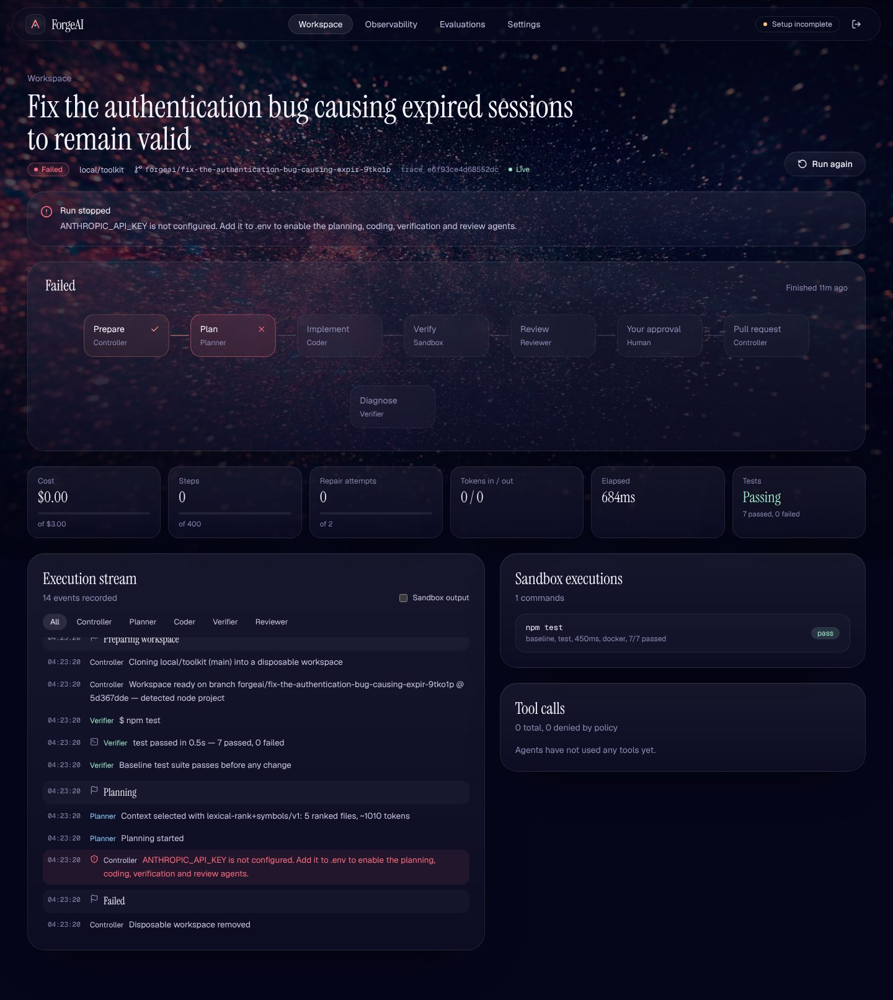
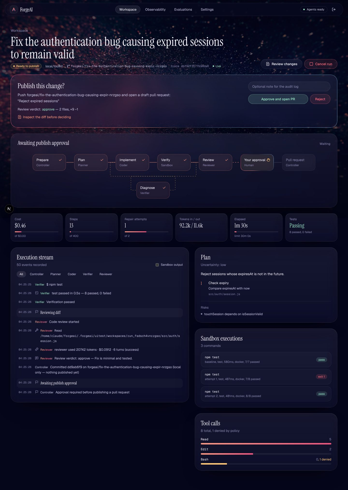
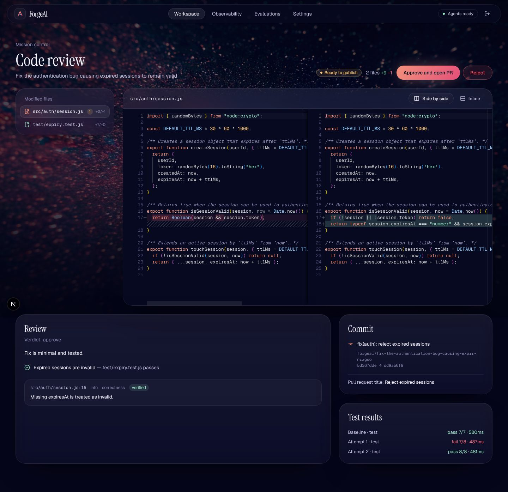
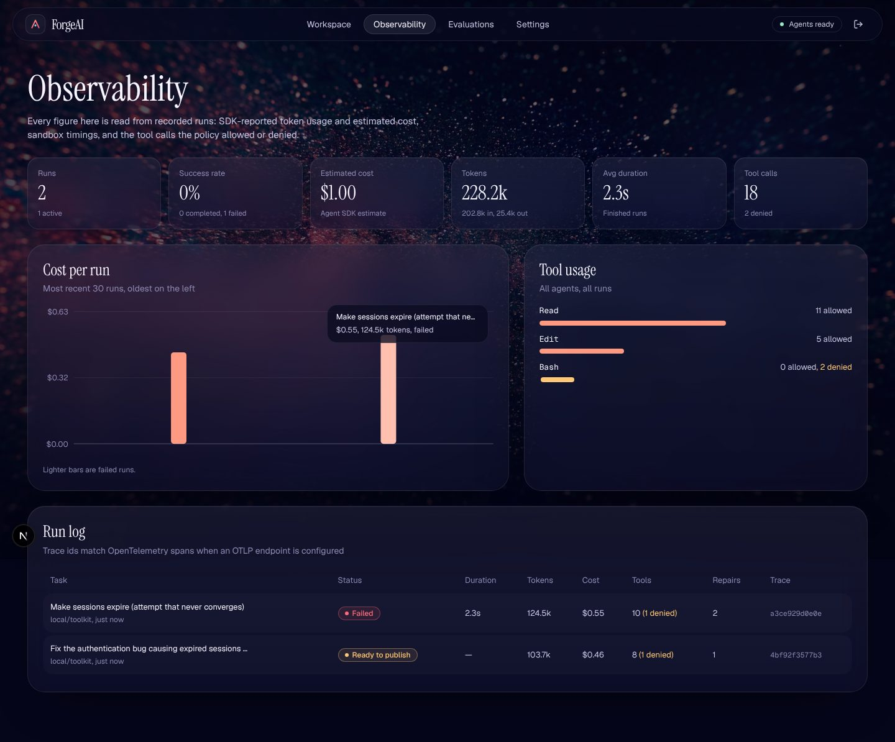

# ForgeAI

**Issues in. Reviewed pull requests out.**

ForgeAI is an autonomous software-engineering agent you run on your own machine. You connect a repository and hand it a GitHub issue or a plain-language request. It then:

1. plans the change,
2. edits a disposable clone,
3. runs your test suite in a locked-down container,
4. diagnoses and repairs failures within a fixed budget,
5. reviews its own diff,
6. waits for your approval before it pushes a branch and opens a draft pull request.


<sub>13-second UI tour ([MP4](docs/media/forgeai-demo.mp4)). The run shown uses demo data from the scripted test model; see the note under Screens.</sub>

## What actually works today

The full vertical slice is implemented. Every step is real code; nothing in the UI is simulated.

| Capability | Status | Verified how |
|---|---|---|
| Operator login (signed HttpOnly cookie, rate-limited, audited) | ✅ | Playwright e2e |
| Connect GitHub repos (fine-grained PAT, Octokit) and local git repos (allow-listed folders) | ✅ GitHub path built, ✅ local path exercised | Local: API flow test. GitHub: built against the Octokit API but **not exercised end-to-end** in the build environment |
| Issue retrieval, branch listing | ✅ | GitHub path not exercised (see above) |
| Disposable clone and branch per run, git hooks disabled, token never written to disk | ✅ | Integration test |
| Context selection (`lexical-rank+symbols/v1`, recorded per run) | ✅ | Unit test: ranks `src/auth/session.js` first for the auth task |
| Planning, coding, verification and review agents on **NVIDIA Nemotron** or **Google Gemini** (OpenAI-compatible API, ForgeAI-owned tool loop and file tools); Claude Agent SDK kept as an option | ✅ implemented | **Not yet run against a live model** — the build environment cannot reach NVIDIA or Google and had no key. The tool loop is tested against a local mock model server; the orchestration with a scripted model. |
| Sandboxed install/test/lint (Docker, `--network none`, `--cap-drop ALL`, read-only root, resource limits) | ✅ | Real run: baseline `npm test` executed in Docker (7/7 pass) |
| Bounded repair loop, budgets (cost/steps/turns/time), cancellation, interrupt and resume | ✅ | Integration tests |
| Human approvals (optional plan gate, mandatory publish gate) | ✅ | Integration tests |
| Publish: push branch and open a draft PR with test evidence; local repos get the branch pushed to origin | ✅ local path verified, GitHub PR path built but not exercised | Integration test |
| Full app run through the OpenAI-compatible path | ✅ | The running app was pointed at a local mock OpenAI-style server (`scripts/mock-model-server.mjs`, a scripted test double): plan → `edit_file`/`write_file` → Docker tests 8/8 → review → approval → branch pushed |
| Live Mission Control over SSE, Monaco side-by-side diff review, observability dashboard | ✅ | Screenshots below |
| PostgreSQL (or embedded PGlite) with migrations and indexes | ✅ both | PGlite in all tests; Postgres 16 migration plus a full run |
| OpenTelemetry trace id per run; OTLP export when configured | ✅ | Trace ids shown in UI and PR body |
| Evaluation harness: 20 tasks with hidden tests | ✅ suite validated, ⏳ agent benchmark not yet run | `npm run eval:validate`: 20/20 tasks valid |

## Screens

| Mission Control (real run, no API key configured) | Mission Control (scripted-model integration run) |
|---|---|
|  |  |

| Code review (scripted-model integration run) | Observability (scripted-model integration run) |
|---|---|
|  |  |

> **About the screenshots.** "Real run, no API key" is a genuine run: clone, branch, project detection and a baseline Docker test run all completed, then planning stopped with a clear error because no key was configured. The "scripted" screenshots come from the controller integration test. Git, the sandbox, the database, the state machine, approvals and the UI are all real there, but the model is a deterministic test double, so its token and cost numbers are synthetic. They show what the UI looks like. They are not evidence of agent quality.

## Quick start

Requirements: Node.js ≥ 20.11 and git. Docker is needed for the secure sandbox. A free API key from **NVIDIA** (build.nvidia.com) or **Google AI Studio** for the agents.

```bash
npm install                       # also copies Monaco into public/ for offline diff viewing
cp .env.example .env              # then fill it in (see below)
npm run sandbox:build             # builds forgeai-sandbox:latest from docker/sandbox.Dockerfile
npm run dev                       # http://localhost:3000
```

Minimum `.env`:

```bash
FORGEAI_ADMIN_EMAIL=you@example.com
FORGEAI_ADMIN_PASSWORD=a-long-passphrase
FORGEAI_SESSION_SECRET=$(openssl rand -hex 32)
FORGEAI_LLM_PROVIDER=nvidia                  # or: google
NVIDIA_API_KEY=nvapi-...                     # build.nvidia.com → any Nemotron model → "Get API Key"
GEMINI_API_KEY=AIza...                       # only if FORGEAI_LLM_PROVIDER=google (aistudio.google.com → Get API key)
FORGEAI_GITHUB_TOKEN=github_pat_...          # fine-grained: Contents RW, Issues R, Pull requests RW, Metadata R
FORGEAI_LOCAL_REPO_ROOTS=/Users/you/code     # optional, for local repositories
```

Then sign in. Connect a repository from the **Workspace** screen, choose **New task**, and follow the run in **Mission Control**.

### Try it without GitHub

```bash
cp -r eval/fixtures/toolkit ~/code/toolkit && cd ~/code/toolkit && git init -b main && git add -A && git commit -m init
```

Add `~/code` to `FORGEAI_LOCAL_REPO_ROOTS`, connect `~/code/toolkit` as a local repository, and ask: *"Fix the authentication bug causing expired sessions to remain valid."*

## Commands

| Command | What it does |
|---|---|
| `npm run dev` / `npm run build && npm start` | Run the app |
| `npm test` | Vitest: policy, redaction, state machine, sessions, context ranking, test-output parsing, the Nemotron/Gemini tool loop against a mock model server, and controller integration tests (scripted model, real git and sandbox) |
| `npm run test:e2e` | Playwright smoke tests (desktop and mobile; auth, every screen, galaxy asset, no horizontal overflow, reduced motion) |
| `npm run eval:validate` | Validates the 20-task suite without calling a model |
| `npm run eval [task ids]` | Runs the real agents on the suite and grades with hidden tests (needs an NVIDIA or Gemini key and the sandbox) |
| `npm run db:migrate` | Apply migrations (also automatic at start) |
| `npm run sandbox:build` | Build the sandbox image |

## Architecture

* [`docs/ARCHITECTURE.md`](docs/ARCHITECTURE.md): specification, component diagram, state machine, data flow, milestones
* [`docs/DATABASE.md`](docs/DATABASE.md): schema and ER diagram
* [`docs/SECURITY.md`](docs/SECURITY.md): threat model and sandbox limitations
* [`docs/EVALUATION.md`](docs/EVALUATION.md): the suite and how it is graded
* [`docs/adr/`](docs/adr): technical decision records

```
src/
  app/                     Next.js routes: landing, login, /app/* screens, /api/* handlers (SSE included)
  components/fx/           Galaxy backdrop, particle field, constellation, scroll reveal
  components/app/          Workflow graph (React Flow), new-task dialog, nav
  server/
    workflow/              Controller, state machine, runner (queue, approvals, resume)
    agents/                Providers (OpenAI-compatible for Nemotron/Gemini, Claude Agent SDK), file tools, roles, prompts, Zod schemas, tool policy
    sandbox/               Docker / process drivers, project detection, test-output parsing
    context/               Repository context selection
    db/                    PGlite / Postgres client, migrations runner, data-access layer
    git.ts, github.ts      Hardened git wrapper, Octokit client
eval/                      Fixture repo, 20 tasks, hidden tests, reference solutions, runner, validator
```

## Design

The interface is built on the supplied galaxy photograph. It is served untouched (2576×1718) as the full-screen backdrop on every screen, with scroll and pointer parallax, a canvas particle field that drifts out of the nebula core in the photo's own colours, slow ambient light, and dark scrims so the white type stays readable. Panels are frosted glass. Display type is Instrument Serif, UI type is Geist, and code is set in Geist Mono. The ember-to-rose gradient marks the single primary action on each screen, ion blue is reserved for anything live (running agents, streaming), and status colours are reserved for state. Motion uses `motion` (Framer Motion): one orchestrated hero entrance, scroll reveals on the landing page, route transitions in the app, and layout animations on navigation and lists. Everything decorative is disabled under `prefers-reduced-motion`, and the particle field pauses when the tab is hidden.

## Known limitations

* **The agent benchmark has not been run.** No completion rate is claimed until `npm run eval` has run with a real key.
* Free tiers are rate-limited. ForgeAI retries 429s with backoff, but long runs can still be slow.
* Gemini and Nemotron tool-calling quality varies by model; the default models are configurable with `FORGEAI_MODEL`.
* The GitHub path (repo connect, issues, push, PR) is implemented but was not exercised end-to-end in the build environment, which had no GitHub token.
* Single-operator authentication. There is no multi-user RBAC and no GitHub App flow yet (a fine-grained PAT is supported).
* Providers: NVIDIA Nemotron and Google Gemini (default path), any OpenAI-compatible endpoint, or Claude via the Agent SDK. Model quality differs; only the protocol is tested.
* Context retrieval is lexical with regex symbol extraction. There is no AST or LSP index yet.
* Runs execute in-process (2 concurrent by default). A multi-node deployment needs an external queue (ADR 0003).
* ForgeAI's own file tools (Nemotron/Gemini path) resolve symlinks before every read and write; the Claude path still checks paths lexically (see SECURITY.md).
* The dependency-install step has network access by default.
* Cost tracking uses the per-token prices you set (0 for free tiers); a token budget (`FORGEAI_MAX_TOKENS`) caps every run.
* There is no light theme; the brief asked for white typography over the galaxy image.
