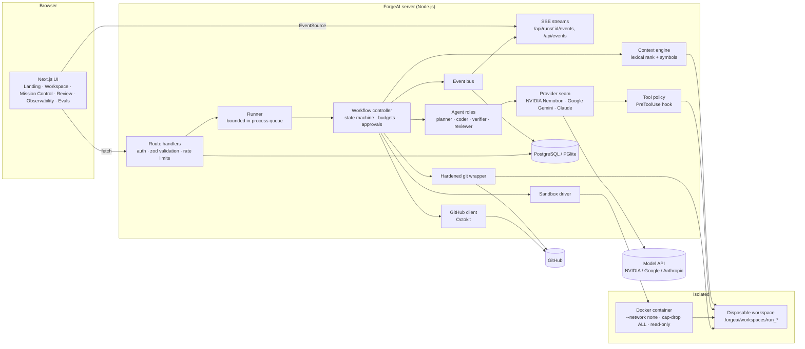
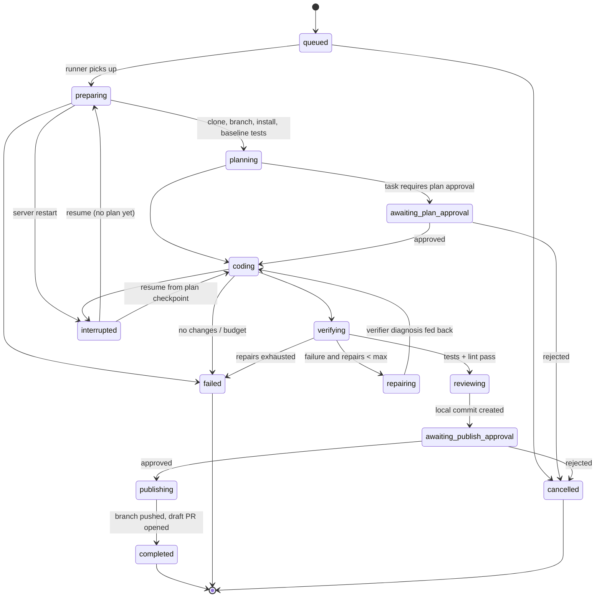

# ForgeAI architecture

## 1. Specification

ForgeAI turns a GitHub issue or a plain-language request into a tested, reviewed branch and — only after a human approves — a draft pull request.

Hard requirements the design is built around:

| Requirement | How it is met |
|---|---|
| Real work, not a simulation | Agents run on NVIDIA Nemotron or Google Gemini (OpenAI-compatible API, ForgeAI-owned tool loop), or Claude via the Agent SDK, on a real clone; tests run in a real container; every number in the UI comes from recorded events. |
| AI code never runs unrestricted on the host | Agents get file tools only (no shell). All execution goes through `src/server/sandbox`, a disposable Docker container with no network for tests. |
| Bounded autonomy | One workflow controller sequences agents and enforces step, cost, repair-attempt and wall-clock budgets plus cancellation. |
| Human in the loop | Optional plan approval; mandatory publish approval. Enforced by the state machine. |
| Untrusted inputs | Repository files, issue bodies and tool output are wrapped as `<untrusted>` data; repo `.claude` settings/hooks are never loaded; git hooks are disabled. |
| Observability | Structured logs (pino, redacted), persisted execution events, tool-call ledger, test results, OpenTelemetry trace ids per run. |

## 2. Component diagram

## 3. Agent execution state machine

Defined in `src/server/workflow/states.ts`; every status change goes through `assertTransition`.

Termination conditions: success, operator cancel, approval rejected, repair budget exhausted, cost/step/time budget exhausted, environmental failure diagnosed with high confidence, coder produced no diff.

## 4. Data flow of one run

1. `POST /api/tasks` creates a task and a run (`queued`) with a fresh OpenTelemetry trace id and a budget snapshot.
2. **Prepare** – clone into `.forgeai/workspaces/<run>` (hooks disabled, credentials passed via one-shot `GIT_CONFIG_*` env), create `forgeai/<slug>-<id>`, detect the project, install dependencies in the sandbox (network allowed only for this step, configurable), run the baseline test suite with no network.
3. **Plan** – the context engine ranks files (`lexical-rank+symbols/v1`, recorded on the run) and the planner explores with read-only tools (`list_files`, `read_file`, `search`), returning a JSON plan validated by Zod.
4. **Implement** – the coder edits with `read_file`/`edit_file`/`write_file`. Every tool call passes the policy and is recorded. (On the Claude path the equivalent built-in tools Read/Edit/Write/Glob/Grep are used.)
5. **Verify** – tests then lint run in the sandbox. On failure the verifier diagnoses (sandbox output is passed as untrusted data) and the coder gets one more attempt, up to `maxRepairAttempts`.
6. **Review** – the reviewer gets the diff plus the verified test table and returns structured findings (each marked verified vs. assumption), commit message and PR title. ForgeAI commits locally.
7. **Approve → publish** – a `publish_pr` approval is created. On approval the branch is pushed and a draft PR is opened whose body contains the plan, the test evidence table and the review. Local repositories get the branch pushed to their origin path instead.
8. Terminal states delete the workspace; the final diff is snapshotted in `agent_runs.diff_snapshot` so review stays possible.

## 5. Implementation milestones

| # | Milestone | Status |
|---|---|---|
| M1 | Architecture docs, schema, state machine, threat model | Done |
| M2 | Vertical slice: connect repo → task → clone → plan → code → sandboxed tests → diff review | Done (agent steps need your API key) |
| M3 | Repair loop, review agent, approvals, publish to GitHub/local | Done |
| M4 | Live UI: workspace, mission control (SSE), diff review (Monaco), observability | Done |
| M5 | Evaluation harness with 20 hidden-test tasks + validation | Done; agent benchmark not yet executed (no key in build environment) |
| M6 | GitHub App auth, multi-user RBAC, Redis queue for multi-node | Not started |
| M7 | Symbol index (tree-sitter / LSP) for context retrieval | Not started |

## 6. Technical decision records

See `docs/adr/`.
