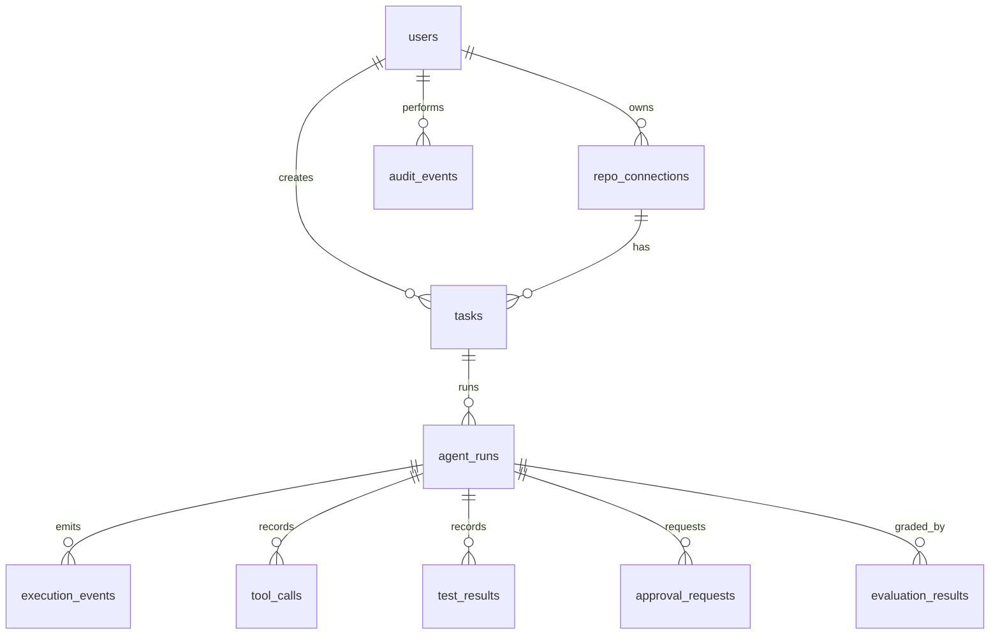

# Database design

PostgreSQL schema in `db/migrations/0001_init.sql`, applied automatically at start (tracked in `schema_migrations`). Without `DATABASE_URL`, ForgeAI uses **PGlite** (Postgres compiled to WASM) persisted in `.forgeai/pgdata`, so the same SQL runs with no external service. Both paths are exercised: tests use in-memory PGlite; migrations and a full scripted run were verified against PostgreSQL 16.

| Table | Purpose | Key indexes |
|---|---|---|
| `users` | Operators | unique email |
| `repo_connections` | GitHub or local repos per user | unique (user, kind, full_name) |
| `tasks` | Requested change (issue / freeform / eval) | (repo_id, created_at desc) |
| `agent_runs` | One execution: status, phase, plan, review, diff snapshot, usage, budget, trace id, PR | (task_id, started_at), status, started_at |
| `execution_events` | Ordered, replayable event log (SSE source of truth) | unique (run_id, seq) |
| `tool_calls` | Every agent tool call with allow/deny decision | (run_id, created_at), tool_name |
| `test_results` | Every sandbox command with exit code, timing, parsed counts, output tail | (run_id, attempt) |
| `approval_requests` | Plan / publish approvals and decisions | partial index on pending, run_id |
| `evaluation_results` | Per-task benchmark metrics | suite_run_id |
| `audit_events` | Security-relevant actions | created_at desc, (target_type, target_id) |

Restartability: a run's status, plan, branch and base commit are durable. On boot, runs that were mid-flight become `interrupted` and can be resumed from the plan checkpoint (workspace reset to the base commit) or from preparation.
